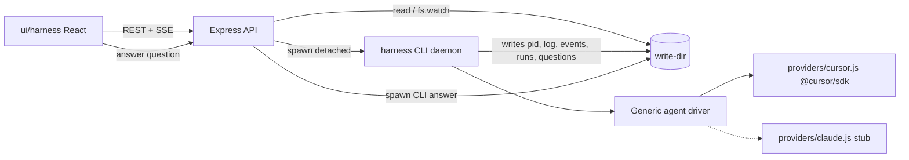

# Cursor SDK Web Harness

## Key design decisions (from SDK research)

- `@cursor/sdk@1.0.30` ships a CJS build and needs Node >= 22.13 (you have 24.11). `services/harness` stays CommonJS JS, factory-arrow style per your rules.
- **Questions**: headless SDK has no built-in human-in-the-loop. We register a `local.customTools.ask_user` tool whose `execute` writes `questions/<qid>.json`, marks the run `awaiting_input`, and awaits an answer file. Provider-agnostic (Claude tool-use can do the same).
- **Pause**: SDK only has `run.cancel()`. `pause` = cancel the in-flight run, keep conversation, mark session `paused`, daemon exits. `resume` = new detached process doing `Agent.resume(providerAgentId)` + send a continuation prompt (default "Continue where you left off"). `stop` is the same cancel but marks the session `stopped`.
- **Plan/execute**: SDK `mode: "plan" | "agent"` on `Agent.create`/`send`. Plan runs also write `result.result` to `runs/<runId>.plan.md`.
- **Tokens/time**: per-turn `usage` stream events + `result.usage` / `result.durationMs`, plus daemon wall-clock. Aggregated into `session.json`.
- **All SDK state in write-dir**: `Cursor.configure({ local: { store: new JsonlLocalAgentStore(<writeDir>/sdk-store) } })`.
- Per your no-build rule I will not run `npm install`; deps go in `package.json` with versions from the registry (`@cursor/sdk` 1.0.30, `express` 5.2.1).

## Architecture



## Write-dir layout

```
<write-dir>/
  sessions/<sessionId>/
    session.json        id, provider, model, cwd, providerAgentId, status, totals {tokens, durationMs}, createdAt
    runs/<runId>.json   mode, prompt, status, pid, startedAt, endedAt, durationMs, usage, result, error
    runs/<runId>.plan.md   (plan-mode output)
    events.jsonl        normalized stream events for all runs
    daemon.log          stdout/stderr of the daemon processes
    daemon.pid          pid of the currently running daemon (removed on exit)
    questions/<qid>.json   {id, runId, question, options, allowMultiple, status, answer}
  sdk-store/            JsonlLocalAgentStore for cursor
```

Session statuses: `idle | running | awaiting_input | paused | stopped | error`.

## Service: `services/harness`

- [package.json](services/harness/package.json): add `bin: { harness: "bin/harness" }`, deps `@cursor/sdk`, `express`; scripts `start`, `cli`. Add `.gitignore` (node_modules, `.harness-data`).
- `src/config.js`: `HARNESS_WRITE_DIR` (default `./.harness-data`), `CURSOR_API_KEY`, `PORT` (default 4317). `env-dir/default/HARNESS_WRITE_DIR` sample file + `scripts/run-with-env-dir` (POSIX sh: export each file in an env-dir then exec).
- `src/store/`: `paths.js` (layout helpers), `jsonFile.js` (read / atomic write via tmp+rename), `sessionStore.js` (create/load/list/update session and run records, aggregate totals), `eventLog.js` (append JSONL, tail from byte offset), `questionStore.js` (write pending question, `awaitAnswer` via `fs.watch` + poll fallback, `answer`).
- `src/agents/driver.js`: the **generic interface** (JSDoc'd) and `createDriver({ provider, ...opts })` registry. Driver shape:
  - `create({ model, cwd, mode, tools })` / `resume(providerAgentId)`
  - `send(prompt, { mode, onEvent })` → `{ cancel, wait }` where `wait()` resolves `{ status, result, usage, durationMs, error }`
  - `listModels()`, `close()`
  - Normalized event union: `text | thinking | tool_call | question | usage | status | result | error`.
- `src/agents/providers/cursor.js`: wraps `Agent.create/resume/send`, `run.stream()` → normalized events, `Cursor.models.list()`, injects `ask_user` custom tool (given a callback from the daemon), maps `mode`.
- `src/agents/providers/claude.js`: stub returning `not_implemented` so UI can list it as disabled.
- `src/harness/Harness.js`: the generic API you asked for, used by CLI and server: `createSession`, `plan`, `run`, `pause`, `resume`, `stop`, `answer`, `status`, `list`. `plan/run/resume` spawn the CLI detached (`spawn(process.execPath, [bin, ...], { detached: true, stdio: 'ignore' }).unref()`); `pause/stop` send SIGTERM to `daemon.pid`; `answer` writes the answer file.
- `src/harness/daemon.js`: body of a long-running process: write `daemon.pid`, open `daemon.log` and redirect stdout/stderr, handle `SIGTERM/SIGINT` → `cancel()` + persist status, drive exactly one run (create or resume agent → send → stream events to `events.jsonl` → persist run + session totals), remove pid, exit.
- `src/harness/process.js`: `spawnDetached`, `isAlive(pid)`, `signal(pid)`.
- `src/cli/index.js` + `bin/harness`: commands `session create`, `plan <sid> --prompt`, `run <sid> --prompt`, `resume <sid> [--prompt]`, `pause <sid>`, `stop <sid>`, `answer <sid> <qid> <json>`, `status <sid>`, `list`, `models`. `plan/run/resume` execute in the foreground unless `--detach`, in which case the CLI re-spawns itself detached and prints the run id. Exit codes: 1 = startup failure (`CursorAgentError`), 2 = run error.
- `src/server/index.js` + `routes.js` + `sse.js`: Express API.
  - `GET /api/providers` (providers + models), `GET/POST /api/sessions`, `GET /api/sessions/:id`
  - `POST /api/sessions/:id/{plan,run,pause,resume,stop}`, `POST /api/sessions/:id/questions/:qid/answer`
  - `GET /api/sessions/:id/events` SSE: replays `events.jsonl`, then `fs.watch` tails events + `session.json`/`runs/*` changes
  - `GET /api/sessions/:id/log` daemon log tail, `GET /api/sessions/:id/runs`
- `Makefile` (help, install, start, cli); root [Makefile](Makefile) mirrors as `services.harness.*` / `ui.harness.*` with explicit targets and help lines.

## UI: `ui/harness`

- Add `component-library` (`file:../../component-library`) + `react-virtuoso` peer; Vite proxy `/api` → `:4317`; fix `index.html` title.
- Replace template `App.jsx`/CSS with:
  - **Sessions sidebar**: list with status `Badge`, provider/model, totals; "New session" `Popup` form (provider `Select`, model `Select` from `/api/providers`, cwd input, initial mode).
  - **Session view**: transcript rendered from SSE events (text, thinking folded, tool calls as `Fold`), mode `Tabs`/toggle (Plan | Execute), prompt textarea + Send, controls `Button`s (Pause / Resume / Stop) enabled by status.
  - **Question card**: shown when a `question` event is pending; options as buttons (multi-select via `Checkbox` when `allowMultiple`) + free-text "Other"; posts the answer.
  - **Metrics panel**: per-run and session totals (input/output/cache/reasoning/total tokens, duration); `ProgressBar`-style bars for token mix; `Timeline` of runs.
  - **Daemon log** `Fold` tail.
- App-specific pieces stay as thin wrappers in `ui/harness/src/` (`api.js`, `useSessionEvents.js`, `components/*`); no generic widgets re-implemented.

## Out of scope for MVP
Cloud runtime, MCP config, hooks, auth for the API, Claude implementation (stub only), question timeouts.