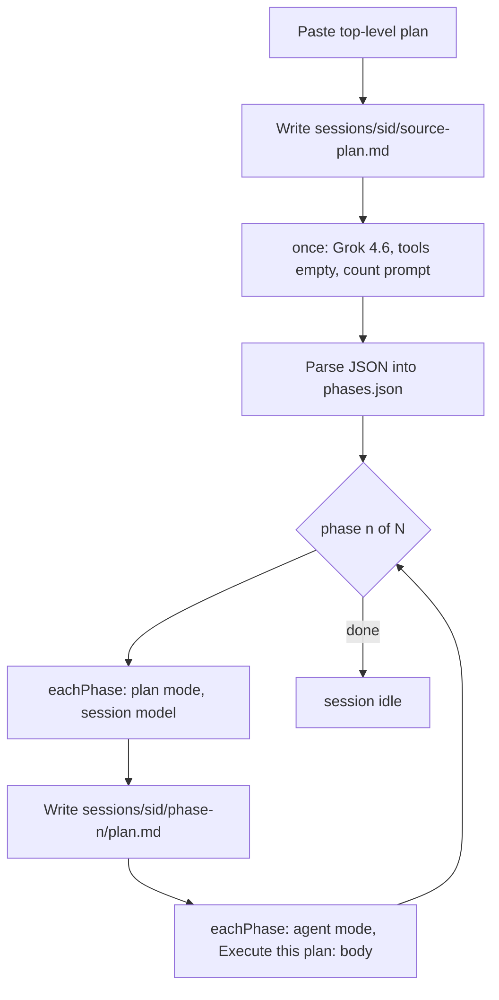

# Decompose mode

Yes: today the harness is a session wrapper around Cursor SDK `mode: "plan" | "agent"`. One detached daemon process runs one turn, then exits. Decompose sits on top of that as a **multi-step orchestrator** on an existing session (cwd / provider / model). Artifacts stay under the session dir — no `jobs/` folder.

## Flow



- **Count** always uses `grok-4.6` with `tools: []` (text-only JSON). SDK has no system-prompt field, so the instruction text is the first user message, from the prompts file.
- **Plan / execute** use the **session model**, fresh `Agent.create` per step (not resume). Plan result is written by the CLI; execute gets the **literal plan.md body**, not the top-level plan.
- Pause / stop reuse the existing session `daemon.pid` + SIGTERM. Resume detects a paused decompose pipeline on the session and continues from the next incomplete step (re-runs a half-finished step).

## Editable prompts + pluggable steps

Two small files, no logic mixed into prompts:

- [`services/harness/src/modes/decompose/prompts.js`](services/harness/src/modes/decompose/prompts.js) — **the only file to edit copy**. Named templates with `{{sourcePlan}}`, `{{currentPhase}}`, `{{totalPhases}}`, `{{phaseTitle}}`, `{{phaseSummary}}`, `{{planBody}}`.
- [`services/harness/src/modes/decompose/pipeline.js`](services/harness/src/modes/decompose/pipeline.js) — ordered step list. Add a step by appending an object (and a prompt key).

```js
// pipeline.js (shape)
[
  { id: 'count', when: 'once', agentMode: 'agent', model: 'grok-4.6', tools: [], promptKey: 'countPhases', parse: 'phaseCount', write: 'count.json' },
  { id: 'plan', when: 'eachPhase', agentMode: 'plan', promptKey: 'planPhase', write: 'plan.md' },
  { id: 'execute', when: 'eachPhase', agentMode: 'agent', promptKey: 'executePhase' },
]
```

Count JSON (enforced in the count prompt + a small parser that strips markdown fences):

```json
{ "count": 3, "phases": [{ "index": 1, "title": "...", "summary": "..." }] }
```

Default prompt gist (you can edit the file later):

- `countPhases`: how many phases/todos/tasks; return that JSON only; include the pasted plan.
- `planPhase`: create an implementation-level plan for phase `{{currentPhase}}/{{totalPhases}}` (`{{phaseTitle}}`), with the top-level plan as context.
- `executePhase`: `Execute this plan:\n\n{{planBody}}`

## On-disk layout

Extend the existing session dir. Existing files stay; decompose adds the plan/phase files next to them.

```
<write-dir>/sessions/<sid>/
  session.json          add mode, currentPhase, totalPhases, currentStep when decomposing
  source-plan.md        pasted top-level plan (user-editable)
  phases.json           parsed count blob
  events.jsonl          same transcript as today; events include phase + step
  daemon.log / daemon.pid / control.json / questions/
  runs/                 existing plan/execute turns unchanged
  phase-1/
    plan.md             CLI-written implementation plan
    plan.json           run record
    execute.json
  phase-2/ ...
```

No `jobId`, no dual-write. Pause/stop already target this session's pid. SSE already tails `events.jsonl`.

## Orchestration (one daemon for the whole pipeline)

Extract a shared **one-turn helper** from [`daemon.js`](services/harness/src/harness/daemon.js) (`create driver → send → stream events → persist run/usage → write plan.md when mode is plan`). Session `plan`/`run` keep using it once.

New [`orchestrator.js`](services/harness/src/modes/decompose/orchestrator.js) is the decompose daemon body:

1. Write pid, load session + `source-plan.md`.
2. Run `when: 'once'` steps in order.
3. For `phase = 1..N`, run `when: 'eachPhase'` steps in order.
4. After each step, update `session.json` (`currentPhase` / `currentStep`) so resume is dumb and reliable.
5. Git snapshot before each step (same as today's CLI).

[`cursor.js`](services/harness/src/agents/providers/cursor.js) `create()` will pass through optional `tools` (for `[]` on count) and per-step `model`.

## API / CLI / UI

- CLI: `harness decompose <sid> --prompt <text> [--detach]` (also `--plan-file`).
- [`Harness.js`](services/harness/src/harness/Harness.js): `decompose(sessionId, { prompt })` writes `source-plan.md`, sets session mode, spawns `decompose` detached (same pattern as `plan`/`run`).
- Resume: if the session is paused mid-decompose (`session.mode === 'decompose'`), spawn the orchestrator with `--resume` instead of a single-agent continue prompt.
- Routes: `POST /api/sessions/:id/decompose` `{ prompt }`. Existing `GET /sessions/:id` already returns session.json (now including phase progress). Existing plan/run/pause/stop stay.
- UI ([`SessionView.jsx`](ui/harness/src/components/SessionView.jsx)): third toggle **Decompose**; large paste textarea; button starts `api.decompose`. Show progress in the side panel (`phase n/N`, current step) from session status.

No new component-library widgets unless something generic is missing; phase progress is app-specific.
