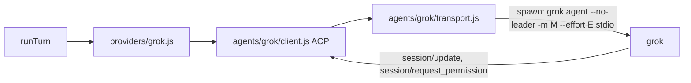

# Grok CLI provider

## Findings
- `grok agent stdio` speaks ACP (Agent Client Protocol) as JSON-RPC 2.0 over stdio. `initialize` reports `loadSession`, `sessionCapabilities.{list,resume,close}`, auth method `cached_token` (from `~/.grok/auth.json`), and `_meta.modelState.availableModels` with per-model `reasoningEfforts`. That means we can list models without opening a session.
- `grok agent` accepts `--model`, `--reasoning-effort`, `--no-leader`, and `--always-approve` before the `stdio` subcommand.
- Drivers are created fresh for each turn in [runTurn.js](services/harness/src/harness/runTurn.js), so model and effort can be fixed when the process is spawned.

## SDK: `services/harness/src/agents/grok/`
- `transport.js`: this follows the pattern in [codexTransport.js](services/harness/src/agents/providers/codexTransport.js), but uses JSON-RPC 2.0 framing with the `jsonrpc: '2.0'` field.
  - It spawns `[bin, 'agent', '--no-leader', ...modelArgs, 'stdio']` in a detached process group.
  - It exposes `request`, `notify`, and responses to incoming agent requests, plus request timeouts and failure fan-out.
  - `close` sends SIGTERM to the process group, then SIGKILL if needed.
  - stderr goes to the daemon log.
- `client.js`: `createGrokClient({ bin, model, reasoningEffort, env, onPermission })` wraps the ACP calls:
  - `initialize({ protocolVersion: 1, clientCapabilities: { fs: { readTextFile: false, writeTextFile: false }, terminal: false } })`
  - `authenticate('cached_token')` when needed. If that fails, the error tells the user to run `grok login`.
  - `models()` reads the model list from the `initialize` metadata.
  - `newSession({ cwd })` and `resumeSession(id, { cwd })`. Resume prefers `session/resume` and falls back to `session/load`, suppressing the updates that `session/load` replays.
  - `setMode(sessionId, modeId)`
  - `prompt(sessionId, text, onUpdate)`, which resolves `{ stopReason, _meta }`
  - `cancel(sessionId)`, sent as the `session/cancel` notification
  - Incoming `session/request_permission` goes to `onPermission`. Any unsupported agent request gets a JSON-RPC error.
- `index.js` re-exports `createGrokClient`.

## Driver: `services/harness/src/agents/providers/grok.js`
This implements the interface in [driver.js](services/harness/src/agents/driver.js):
- `create` / `resume`
  - Starts the client and creates or resumes the ACP session.
  - `providerAgentId()` returns the ACP `sessionId`.
  - Maps harness `mode` to Grok modes: `plan` becomes `plan`, and everything else becomes `default`, set via `session/set_mode`.
  - Rejects a non-empty Cursor `tools` allowlist, as Codex does.
- `send`
  - Maps `session/update` events:
    - `agent_message_chunk` becomes a `text` delta, with one `itemId` per message.
    - `agent_thought_chunk` becomes a `thinking` delta.
    - `tool_call` and `tool_call_update` become `tool_call` events. `itemId` is the `toolCallId`, `name` is the title or kind, `input` is `rawInput`, `output` comes from `content` or `rawOutput`, and `status` is passed through.
    - `plan` becomes a `plan` event.
    - Usage from `_meta` becomes a `usage` event.
    - `current_mode_update` becomes a `status` event.
  - Maps the stop reason: `end_turn` becomes `completed`, `cancelled` becomes `cancelled`, and anything else becomes `error`. The final result text is the concatenated agent message text.
  - `cancel()` sends `session/cancel`. If no result arrives within 5s, it forces `cancelled` and closes the process.
- Permissions: permission requests go to `tools.askUser` as `{ kind: 'approval', options: option names }`, and the reply is `{ outcome: { outcome: 'selected', optionId } }`. If `askUser` is unavailable, the driver chooses the first `reject_*` option.
- `listModels()` returns `{ id, displayName, defaultReasoningEffort, supportedReasoningEfforts: [{ reasoningEffort }] }`, the same shape `CodexSettings` uses.
- No `ask_user` custom tool in this version. ACP only exposes it through MCP servers, so that is a follow-up.

## Wiring
- [config.js](services/harness/src/config.js): add `grokBin`, resolved from `HARNESS_GROK_BIN`, then PATH, then `~/.local/bin/grok`.
- New `providers/grokOptions.js`: `normalizeGrokOptions({ reasoningEffort })`, with choices `low`, `medium`, `high`, and `xhigh`.
- [driver.js](services/harness/src/agents/driver.js): add `grok: () => require('./providers/grok')`.
- [sessionStore.js](services/harness/src/store/sessionStore.js): `createSession` accepts `grok` and stores `session.grok`.
- [Harness.js](services/harness/src/harness/Harness.js): pass `grok` through in `createSession` and fork.
- [routes.js](services/harness/src/server/routes.js): accept `grok` in both session-create bodies.
- [runTurn.js](services/harness/src/harness/runTurn.js): pass `grok: session.grok` to `createDriver`.
- The driver validates `reasoningEffort` against the selected model's efforts.
- [pipeline.js](services/harness/src/modes/decompose/pipeline.js): add a `grok` override to the count step: `{ model: null, tools: undefined, agentMode: 'plan' }`. It relies on the existing JSON text parser.
- [cli/index.js](services/harness/src/cli/index.js): make `--reasoning-effort` work with `--provider grok`, and add a Grok runtime section to the help text covering `HARNESS_GROK_BIN` and `grok login`.

## UI
- New [GrokSettings.jsx](ui/harness/src/components/GrokSettings.jsx): a reasoning-effort dropdown built from `model.supportedReasoningEfforts`, with fresh DevScope IDs.
- [NewSessionForm.jsx](ui/harness/src/components/NewSessionForm.jsx): add `grok` state, send `{ grok }` when the provider is `grok`, reset effort when the provider or model changes, and render `GrokSettings`.
- [SessionView.jsx](ui/harness/src/components/SessionView.jsx): show `session.grok?.reasoningEffort` next to the Codex effort.

## To confirm during implementation
Before hardcoding ACP method names and shapes, read the `session/new` response. It should show the mode IDs, whether `session/resume` needs `cwd`/`mcpServers`, and where usage metadata lives.
