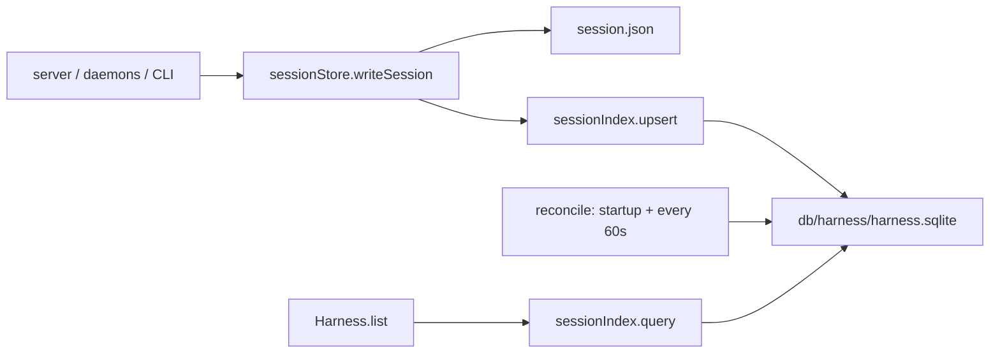

# sSQLite session index for harness

## Why it is slow

- Every `GET /api/sessions` and `GET /api/workspaces/:id/sessions` goes through `Harness.list` -> `sessionStore.listSessionsAsync`, which runs `readdir` on every workspace and `JSON.parse` on every `session.json`. Only after that does it filter, sort, and apply the limit ([services/harness/src/harness/Harness.js](services/harness/src/harness/Harness.js) lines 223-237, [services/harness/src/store/sessionStore.js](services/harness/src/store/sessionStore.js) lines 155-205).
- On load, the UI makes three of these calls: the sidebar call plus two unscoped jobs-panel calls. All three repeat every 3 seconds ([ui/harness/src/App.jsx](ui/harness/src/App.jsx) lines 240-275, 348-354).
- `db/harness` is already a SQLite Sqitch project with an empty `v1.000.0`. No session index exists yet.

## Approach

The files stay authoritative. SQLite works as a write-through index: each `session.json` write also upserts a row, and a stat-based reconcile catches anything that was missed.

## Changes

- **Migration** `db/harness/deploy/v1.001.0.sql` (requires `[v1.000.0]`; revert and verify files left empty; listed in `sqitch.plan`). It is transactional and idempotent (`CREATE ... IF NOT EXISTS`, `INSERT OR IGNORE`):
  - Lookup tables `main.session_status` (idle, running, awaiting_input, paused, stopped, finished, error, disconnected) and `main.provider` (cursor, codex, grok, claude).
  - `main.session` columns, in this order: `id` (UUID text PK), `status` FK, `provider` FK, then `session_id` (unique), `workspace_id`, `name`, `model`, `archived`, `pinned`, `source_mtime_ms`, `data` (full persisted session JSON), then `created_at` and `updated_at` (epoch ms).
  - Indexes on `(workspace_id, archived, created_at)`, `(status)`, and `(updated_at)`.
  - SQLite does not support some conventions in our database rules. Instead of `citext`, use `TEXT COLLATE NOCASE`. For schema qualification, use the `main.` prefix.
- **Config** [services/harness/src/config.js](services/harness/src/config.js): add `const HARNESS_DB_PATH = process.env.HARNESS_DB_PATH`. By default, `dbPath` resolves from `__dirname` to `db/harness/harness.sqlite`, so daemons spawned with a different cwd still find it.
- **New** `services/harness/src/store/sessionIndex.js`, built on `node:sqlite` `DatabaseSync`. No new npm dependency is needed because `@cursor/sdk` already requires Node 22.13 or later.
  - Opens lazily with WAL mode and a 5s busy timeout, which is safe with the server, daemons, and CLI writing concurrently. Throws a clear "run `make db.harness.deploy`" error if `main.session` is missing.
  - `upsert(session, mtimeMs)`: if the row write fails, it logs and does not throw, so a daemon run is never broken by the index.
  - `query({ workspaceId, includeArchived, active, orderBy, order, limit })`: filters, sorts, and limits in SQL and returns the parsed `data`.
  - `reconcile(writeDir)`: walks the session dirs (workspace and legacy), stats each `session.json`, and re-parses only files whose mtime differs from the row. It deletes rows whose file no longer exists. Legacy sessions with no `workspaceId` get one at index time, using the same match-by-cwd rule as `listSessionsInWorkspaceAsync`.
- **sessionStore** [services/harness/src/store/sessionStore.js](services/harness/src/store/sessionStore.js): add `writeSession(next, writeDir)`, which writes the JSON, then stats it and calls `sessionIndex.upsert`. Use it at the three write sites: `createSession` (line 70), `updateSession` (line 211), and `rebuildTotals` (line 551). Keep `listSessionsAsync` for the CLI and reconcile.
- **Harness.list** [services/harness/src/harness/Harness.js](services/harness/src/harness/Harness.js): replace the full scan with `sessionIndex.query`. Keep `recoverDeadDaemon` for busy rows only, then attach cwd, `logPath`, and `eventsPath` with `withCwd`, using one `listWorkspacesAsync` map. The response shape does not change, so no UI change is needed.
- **Server startup** [services/harness/src/server/index.js](services/harness/src/server/index.js): after `ensureLayout`, start `reconcile` and have list requests await that first promise. After that, run `reconcile` every 60s with `setInterval(...).unref()`.
- **Makefiles**: in the root `start`, run `$(MAKE) db.harness.deploy` before launching child processes. Add an `index.rebuild` target to [services/harness/Makefile](services/harness/Makefile) that runs the CLI `reindex` subcommand, and mirror it at the root as `services.harness.index.rebuild` with `.PHONY`, a help line, and explicit forwarding.

## Out of scope (possible follow-ups)

- UI paging or lowering the 3s poll rate.
- Indexing runs and events. Opening a session still replays `events.jsonl`.

